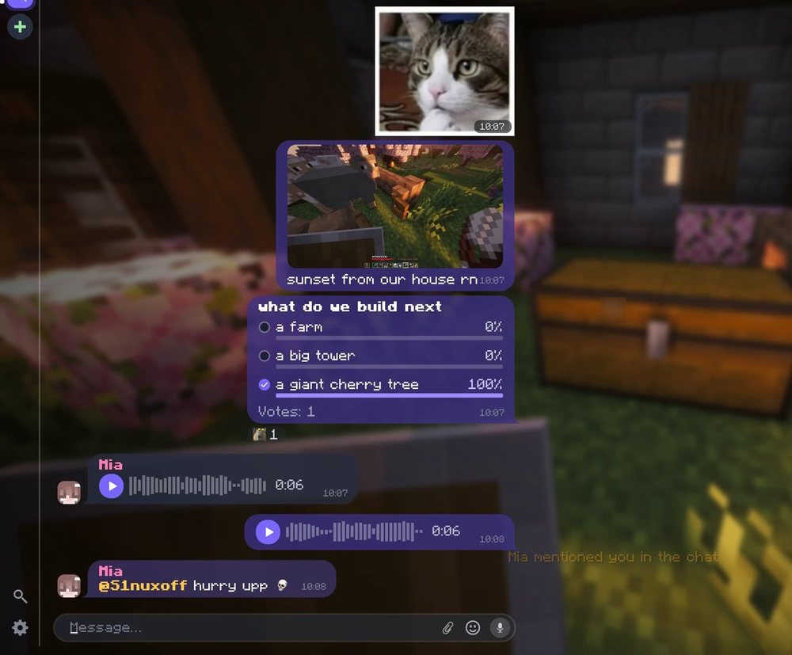

<div align="center">


# InGame Messenger

**A real messenger inside the Minecraft chat.**<br>
Stickers, voice messages, pictures, reactions, replies, private chats, polls and search, for every player on your server.

[](https://github.com/S1nuxoff/InGame-Messenger/releases/latest)

[](https://github.com/S1nuxoff/InGame-Messenger/actions/workflows/build.yml)
[](https://s1nuxoff.github.io/InGame-Messenger-tests/)
[](LICENSE)

<table><tr><td align="center" width="84"><br><sub><b>1.19.2 – 26.3</b></sub></td><td align="center" width="84"><br><sub><b>Fabric</b></sub></td><td align="center" width="84"><br><sub><b>Quilt</b></sub></td><td align="center" width="84"><br><sub><b>NeoForge</b></sub></td><td align="center" width="84"><br><sub><b>Forge</b></sub></td><td align="center" width="84"><br><sub><b>Paper</b></sub></td><td align="center" width="84"><br><sub><b>Spigot</b></sub></td><td align="center" width="84"><br><sub><b>Purpur</b></sub></td><td align="center" width="84"><br><sub><b>Folia</b></sub></td></tr></table>

[Features](#features) · [Installation](#installation) · [Versions](#supported-versions) · [Server guide](docs/server.md) · [Contributing](CONTRIBUTING.md)



</div>

## What it is

InGame Messenger replaces the plain Minecraft chat with a messenger, right where the chat is. The server's chat stays
the place where everyone talks and where commands are typed; it just gets bubbles with faces, stickers, voice, pictures,
reactions and replies, plus private chats next to it.

- **Players** install the mod. On a server without it, nothing changes: the chat stays the normal Minecraft chat.
- **Servers** run the mod (NeoForge, Fabric, Forge) or the plugin (Paper, Spigot, Purpur, Folia). The client's and the
  server's loader don't have to match.
- **Players without the mod** can still join and chat; they see stickers, voice messages, pictures and polls as short
  text lines.

## Features

### 💬 Chat
- Bubbles with the sender's face, name and time; messages from one player are grouped, with a tail on the last one.
  Your own messages can sit on the right, like on a phone.
- Replies with a quote (click it to jump to the original, however far back), editing and deleting your own messages.
- Reactions: built-in ones plus the server's emoji, on messages and stickers. Double-click a message for a heart.
- @mentions with autocompletion; mentions of you are highlighted and announced above the hotbar.
- "Player is typing...", date separators, smooth scrolling.
- The server's own lines (joins, deaths, announcements, command answers) come from the server with its name and icon,
  keeping their colors, links and hover texts.
- Names look the way the server shows them: ranks and colors from the server or LuckPerms/Vault.
- Commands work from anywhere. Typed in a private chat, the answer appears right there, visible only to you.

### 🔒 Private chats
- One-to-one chats in a list next to the server's chat, with unread counters and notifications.
- Read receipts: one check when sent, two when read.

### 🖼️ Stickers, pictures, voice
- Sticker and emoji packs come from the server (PNG, JPG, animated GIF). Sticker panel with recent, favourites and
  every pack; hold the chat key for a quick picker.
- Pictures: up to four per message with a caption, from a file, an in-game screenshot or the clipboard (Ctrl+V).
- Voice messages: hold the microphone button to record, release to send. Waveform, 1x/1.5x/2x speed, a mini player
  that keeps playing while you move. Opus, no other mod needed.
- Shared coordinates become a card; with JourneyMap a click makes a waypoint.

### 📊 More
- Polls with one or several answers.
- Search through every chat you can see (Ctrl+F); a result opens its chat at the message.
- Settings for size and scale, sticker size, microphone, output device, gain, noise gate.
- 40 languages.

### 🛠️ For server owners
- Mutes in the server's chat, in private chats or both, for a time or for good. They also stop `/msg` and `/me`;
  mutes from EssentialsX, LiteBans and AdvancedBan count too (plugin).
- Works with chat plugins such as EssentialsX Chat: each line shows once, with the rank and colors the server gives it.
- History in a database: H2 by default (nothing to set up), or MySQL, MariaDB, PostgreSQL. Voice messages and pictures
  in the world folder or any S3-compatible storage; old files are cleaned up automatically.
- The server's name and icon in the messenger (the MOTD and the server list icon by default).
- One config file, reloadable in game. Velocity and BungeeCord: install on the servers behind the proxy, nothing on
  the proxy; each server keeps its own chat.

## Installation

### Players
1. Download the jar for your Minecraft version and loader from [Releases](https://github.com/S1nuxoff/InGame-Messenger/releases/latest).
2. Put it in your `mods` folder. On Fabric and Quilt, also install [Fabric API](https://modrinth.com/mod/fabric-api).
3. Join a server that has the mod or the plugin.

### Servers
1. **Modded server:** the mod's jar in `mods` (plus Fabric API on Fabric and Quilt).
   **Paper, Spigot, Purpur, Folia:** the plugin's jar in `plugins`.
2. Start the server once. It creates `config/ingamemessenger/` (plugin: `plugins/InGameMessenger/`) with the config
   and the folders for sticker and emoji packs.
3. Add sticker packs if you like, then run `/messenger reload`.

The defaults need no changes. The [server guide](docs/server.md) covers every option, external databases, S3, sticker
packs, commands and permissions.

## Supported versions

 **22 Minecraft versions, from 1.19.2 to 26.3.**

| | Platform | Versions |
|:-:|---|---|
|   | **Fabric, Quilt** | 1.19.2 · 1.20 · 1.20.1 · 1.20.3 · 1.20.4 · 1.20.5 · 1.20.6 · 1.21 · 1.21.1 · 1.21.4 – 1.21.11 · 26.1 – 26.3 |
|  | **NeoForge** | 1.20.6 · 1.21 · 1.21.1 · 1.21.4 – 1.21.11 · 26.1 – 26.3 |
|  | **Forge** | 1.19.2 · 1.20.1 · 1.20.4 · 1.20.6 · 1.21.1 · 1.21.4 · 1.21.5 · 1.21.8 · 1.21.10 · 1.21.11 · 26.1.2 · 26.2 · 26.3 |
|    | **Paper, Spigot, Purpur** (plugin) | 1.20.1 and newer |
|  | **Folia** (plugin) | every Folia release from 1.21.4 |

<details>
<summary><b>Full table</b> (every version, loader and the Java it needs)</summary>

| Minecraft | <br>NeoForge | <br>Fabric | <br>Quilt | <br>Forge |   <br>Paper, Spigot, Purpur | <br>Folia | Java |
|-----------|:--------:|:------:|:-----:|:-----:|:------------------------------:|:--------------:|:----:|
| 1.19.2    |    —     |   ✓    |   ✓   |   ✓   |               —                |       —        |  17  |
| 1.20      |    —     |   ✓    |   ✓   |   —   |               —                |       —        |  17  |
| 1.20.1    |    —     |   ✓    |   ✓   |   ✓   |               ✓                |       —        |  17  |
| 1.20.3    |    —     |   ✓    |   ✓   |   —   |               —                |       —        |  17  |
| 1.20.4    |    —     |   ✓    |   ✓   |   ✓   |               ✓                |       —        |  17  |
| 1.20.5    |    —     |   ✓    |   ✓   |   —   |               —                |       —        |  21  |
| 1.20.6    |    ✓     |   ✓    |   ✓   |   ✓   |               ✓                |       —        |  21  |
| 1.21      |    ✓     |   ✓    |   ✓   |   —   |               —                |       —        |  21  |
| 1.21.1    |    ✓     |   ✓    |   ✓   |   ✓   |               ✓                |       —        |  21  |
| 1.21.4    |    ✓     |   ✓    |   ✓   |   ✓   |               ✓                |       ✓        |  21  |
| 1.21.5    |    ✓     |   ✓    |   ✓   |   ✓   |               ✓                |       ✓        |  21  |
| 1.21.6    |    ✓     |   ✓    |   ✓   |   —   |               ✓                |       ✓        |  21  |
| 1.21.7    |    ✓     |   ✓    |   ✓   |   —   |               ✓                |       ✓        |  21  |
| 1.21.8    |    ✓     |   ✓    |   ✓   |   ✓   |               ✓                |       ✓        |  21  |
| 1.21.9    |    ✓     |   ✓    |   ✓   |   —   |               ✓                |       —        |  21  |
| 1.21.10   |    ✓     |   ✓    |   ✓   |   ✓   |               ✓                |       —        |  21  |
| 1.21.11   |    ✓     |   ✓    |   ✓   |   ✓   |               ✓                |       ✓        |  21  |
| 26.1      |    ✓     |   ✓    |   ✓   |   —   |               ✓                |       ✓        |  25  |
| 26.1.1    |    ✓     |   ✓    |   ✓   |   —   |               ✓                |       ✓        |  25  |
| 26.1.2    |    ✓     |   ✓    |   ✓   |   ✓   |               ✓                |       ✓        |  25  |
| 26.2      |    ✓     |   ✓    |   ✓   |   ✓   |               ✓                |       ✓        |  25  |
| 26.3      |    ✓     |   ✓    |   ✓   |   ✓   |               ✓                |       —        |  25  |

- Fabric builds need [Fabric API](https://modrinth.com/mod/fabric-api). On Quilt, use the Fabric jar with Fabric API.
- Some versions share a jar: the 1.20.1 Fabric jar also runs on 1.20, the 1.20.4 one on 1.20.3, the 1.20.6 one on
  1.20.5, the 1.21.1 Fabric and NeoForge jars on 1.21; one jar covers 1.21.6 – 1.21.8, another 1.21.9 – 1.21.10,
  another 26.1 – 26.1.2. Forge builds are made for one Minecraft release each, as Forge itself is.
- Each jar installs only on the versions it is made for. Not supported yet: 1.19.3, 1.19.4, 1.20.2, 1.21.2, 1.21.3.

</details>

Every version is tested in the game: the mod plays a scenario by itself against a test server (messages, stickers,
pictures, voice, polls, private chats, mutes) and every step is screenshotted.
[See the latest test runs.](https://s1nuxoff.github.io/InGame-Messenger-tests/)

## Controls

<details>
<summary>Show</summary>

| Action | How |
|---|---|
| Open the chat | Tap the chat key (T) |
| Quick sticker picker | Hold the chat key, click a sticker, release |
| Sticker panel | Smiley button in the input; right-click it to pin the panel open |
| Favourite a sticker / preview it | Right-click it / press and hold it in the panel |
| React | Hover the message and click the reaction button, or double-click the message |
| Reply, copy, edit, delete | Right-click the message |
| Jump to the quoted message | Click the quote |
| Player menu (private chat, mention) | Click a player's face |
| Voice message | Hold the microphone button (shown when the input is empty) |
| Attach a picture, location, poll | Paper clip button |
| Paste a picture | Ctrl+V |
| Search | Ctrl+F, or the magnifier at the bottom of the chat list |
| Settings | Gear button at the bottom of the chat list |

</details>

## Privacy

Messages, private chats included, are stored on the server in plain form, so the server's operators can read them, as
on any chat platform. Voice messages and pictures are kept for a set number of days, then deleted.

## Building from source

Needs JDK 21 or newer (JDK 25 for the 26.x builds is downloaded automatically).

```sh
./gradlew buildAll                 # every version and loader
./gradlew :1.21.1-neoforge:build   # one of them
./gradlew :plugin:build            # the server plugin
./gradlew :core:test               # unit tests
```

Jars end up in `versions/<minecraft>-<loader>/build/libs/` and `plugin/build/libs/`. Every version is built from one
source tree with [Stonecutter](https://stonecutter.kikugie.dev/); see [CONTRIBUTING.md](CONTRIBUTING.md).

## Contributing

Bug reports, ideas, translations and pull requests are welcome. Please read [CONTRIBUTING.md](CONTRIBUTING.md) first.

## License

Free software under the [GNU General Public License v3.0](LICENSE), with an attribution term in
[NOTICE.md](NOTICE.md). Third-party assets and libraries are listed in [CREDITS.md](CREDITS.md).
