

[English](README.md) · [Українська](README.uk.md) · **Русский**

 

[Обзор](#обзор) · [Возможности](#возможности) · [Установка](#установка) · [Версии](#поддерживаемые-версии) · [Вопросы](#частые-вопросы) · [Для серверов](docs/server.md) · [Помочь проекту](CONTRIBUTING.md)

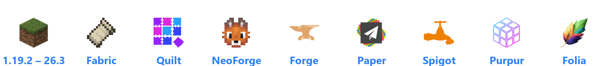

## Обзор

InGame Messenger превращает обычный чат Minecraft в полноценный мессенджер. Всё происходит в том же окне чата:
общий чат и команды на месте, просто сообщения теперь выглядят как в привычных мессенджерах — с аватарками,
стикерами, голосовыми, картинками, реакциями и ответами. А рядом — личные чаты. Никаких аккаунтов и облаков:
всё хранится на вашем сервере.

<table>
<tr>
<td width="33%" valign="top">

**Игрокам** 
Просто поставьте мод. На серверах без него чат останется обычным.

</td>
<td width="33%" valign="top">

**Серверам** 
Нужен мод (NeoForge, Fabric, Forge) или плагин (Paper, Spigot, Purpur, Folia). Лоадер у игрока и на сервере
может быть разным.

</td>
<td width="33%" valign="top">

**Игрокам без мода** 
Тоже могут играть и писать в чат. Стикеры, голосовые, картинки и опросы они увидят короткой строкой текста.

</td>
</tr>
</table>

## Как это выглядит

https://github.com/user-attachments/assets/48dfbc2b-96dd-4af4-9ba5-352966471e95

## Возможности

### 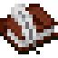 Чат как в мессенджере

<table>
<tr>
<td width="50%" valign="middle">

- **Сообщения в пузырях** — с аватаркой, ником и временем. Несколько сообщений подряд от одного игрока собираются в группу.
- **Сообщения сервера** (входы, смерти, объявления, ответы на команды) подписаны его названием и иконкой.
- **Ники с рангами и цветами** — так, как их показывает сервер или LuckPerms/Vault.
- **«Печатает…»**, даты между сообщениями, плавная прокрутка.

</td>
<td width="50%" align="center" valign="middle">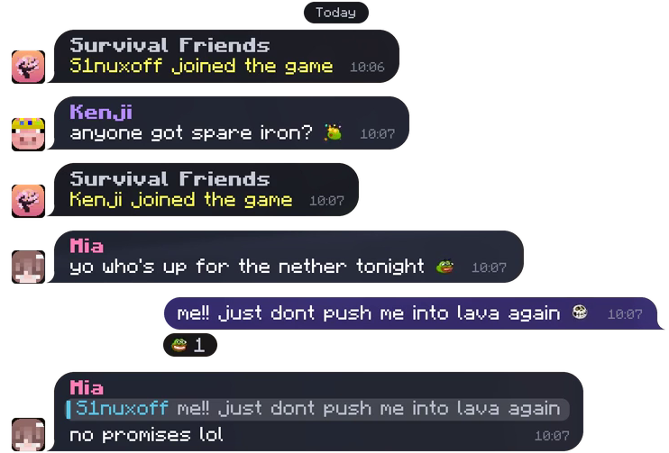</td>
</tr>
</table>

###  Ответы и реакции

<table>
<tr>
<td width="50%" align="center" valign="middle">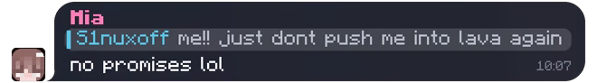  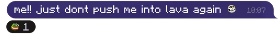</td>
<td width="50%" valign="middle">

- **Отвечайте с цитатой.** Нажмите на цитату — и чат перемотает к исходному сообщению, даже если оно было давно.
- **Ставьте реакции** — стандартные или эмодзи сервера. Двойной клик по сообщению — сердечко.
- Свои сообщения можно редактировать и удалять.

</td>
</tr>
</table>

###  Упоминания

<table>
<tr>
<td width="50%" valign="middle">

- **Упоминайте через @** — ник подставится сам.
- Если упомянули вас, сообщение подсветится, а над хотбаром появится уведомление — даже когда чат закрыт.

</td>
<td width="50%" align="center" valign="middle">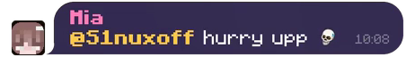</td>
</tr>
</table>

### 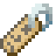 Личные чаты

<table>
<tr>
<td width="50%" align="center" valign="middle">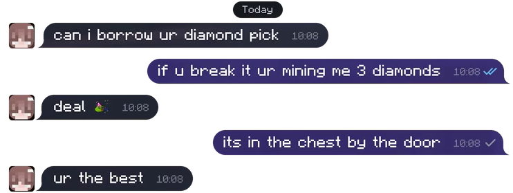</td>
<td width="50%" valign="middle">

- Переписки один на один в списке рядом с общим чатом, со счётчиком непрочитанных и уведомлениями.
- **Галочки**: одна — отправлено, две — прочитано.
- **Команды работают из любого чата.** Ответ на команду из лички придёт туда же и будет виден только вам.

</td>
</tr>
</table>

###  Стикеры и эмодзи

<table>
<tr>
<td width="50%" valign="middle">

- **Наборы стикеров добавляет сервер**: PNG, JPG и анимированные GIF.
- В панели — недавние, избранные и все наборы. Зажмите клавишу чата, чтобы быстро выбрать стикер.
- Эмодзи сервера можно вставлять прямо в текст и ставить как реакции.

</td>
<td width="50%" align="center" valign="middle">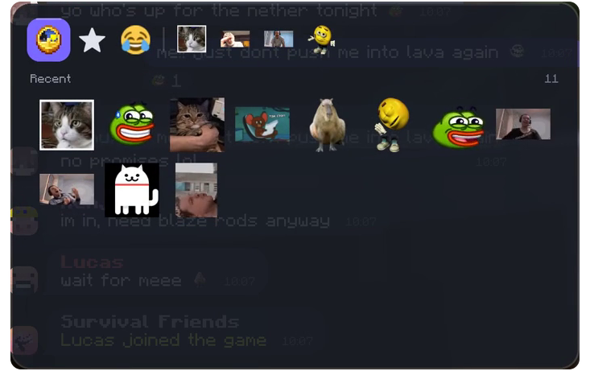</td>
</tr>
</table>

### 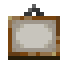 Картинки

<table>
<tr>
<td width="50%" align="center" valign="middle">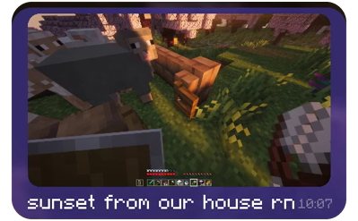</td>
<td width="50%" valign="middle">

- До четырёх картинок в сообщении, можно с подписью.
- Из файла, из скриншота игры или вставкой из буфера (Ctrl+V).
- Координаты отправляются карточкой, а с JourneyMap по клику сразу ставится метка.

</td>
</tr>
</table>

### 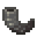 Голосовые сообщения

<table>
<tr>
<td width="50%" valign="middle">

- **Зажмите кнопку микрофона** и говорите, отпустите — сообщение уйдёт.
- Видно волну звука, слушать можно на 1x, 1.5x и 2x, а мини-плеер играет дальше, пока вы бегаете.
- Работает само по себе, другие моды не нужны.

</td>
<td width="50%" align="center" valign="middle">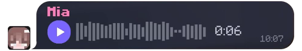  </td>
</tr>
</table>

###  Опросы

<table>
<tr>
<td width="50%" align="center" valign="middle">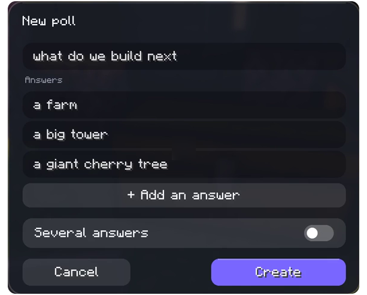  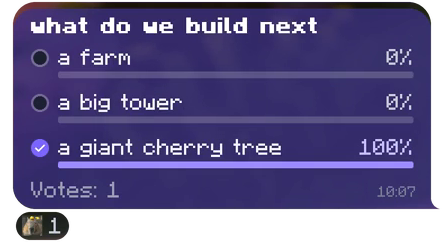</td>
<td width="50%" valign="middle">

- С одним или несколькими вариантами ответа, результаты обновляются сразу.
- Создаются в отдельном окне прямо из чата.

</td>
</tr>
</table>

### 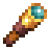 Поиск, настройки, языки
- Поиск по всем вашим чатам (Ctrl+F) — нажмите на результат, и откроется нужное место.
- Настраивается размер чата и стикеров, микрофон, устройство вывода звука, громкость и шумоподавление.
- 40 языков.

### 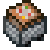 Для владельцев серверов
- **Муты** — в общем чате, в личных сообщениях или везде, на время или навсегда. Мут также блокирует `/msg` и `/me`.
  Муты из EssentialsX, LiteBans и AdvancedBan тоже работают (в плагине).
- **Дружит с чат-плагинами** вроде EssentialsX Chat: каждое сообщение показывается один раз, с рангом и цветами от сервера.
- **История** хранится в H2 — ничего настраивать не нужно. Можно подключить MySQL, MariaDB или PostgreSQL. Голосовые и
  картинки лежат в папке мира или в любом S3-хранилище, старые удаляются сами.
- В мессенджере видно **название и иконку вашего сервера** (по умолчанию берутся MOTD и иконка из списка серверов).
- **Все настройки в одном файле**, перезагрузить можно прямо в игре.

## Установка

### Игрокам
1. Скачайте jar под свою версию Minecraft и лоадер со страницы [Releases](https://github.com/S1nuxoff/InGame-Messenger/releases/latest) или с [CurseForge](https://www.curseforge.com/minecraft/mc-mods/ingame-messenger).
2. Закиньте его в папку `mods`. Для Fabric и Quilt нужен ещё [Fabric API](https://modrinth.com/mod/fabric-api).
3. Заходите на сервер, где стоит мод или плагин.

### Серверам
1. **Сервер с модами:** jar мода — в `mods` (на Fabric и Quilt ещё Fabric API). 
   **Paper, Spigot, Purpur, Folia:** jar плагина — в `plugins`.
2. Запустите сервер один раз — он создаст папку `config/ingamemessenger/` (у плагина `plugins/InGameMessenger/`)
   с настройками и папками для стикеров и эмодзи.
3. Добавьте свои стикеры, если хотите, и выполните `/messenger reload`.

Настройки по умолчанию подходят сразу. Все параметры, внешние базы, S3, стикеры, команды и права описаны в
[руководстве для сервера](docs/server.md) (на английском).

## Поддерживаемые версии

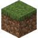 **22 версии Minecraft — от 1.19.2 до 26.3.**

| Платформа | Версии |
|---|---|
| 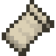 **Fabric** · 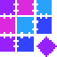 **Quilt** | 1.19.2 · 1.20 · 1.20.1 · 1.20.3 · 1.20.4 · 1.20.5 · 1.20.6 · 1.21 · 1.21.1 · 1.21.4 – 1.21.11 · 26.1 – 26.3 |
|  **NeoForge** | 1.20.6 · 1.21 · 1.21.1 · 1.21.4 – 1.21.11 · 26.1 – 26.3 |
|  **Forge** | 1.19.2 · 1.20.1 · 1.20.4 · 1.20.6 · 1.21.1 · 1.21.4 · 1.21.5 · 1.21.8 · 1.21.10 · 1.21.11 · 26.1.2 · 26.2 · 26.3 |
|  **Paper** ·  **Spigot** ·  **Purpur** | плагин, 1.20.1 и новее |
|  **Folia** | плагин, все версии Folia начиная с 1.21.4 |

<b>Полная таблица</b> (все версии, лоадеры и нужная Java)

| Minecraft |  NeoForge |  Fabric |  Quilt |  Forge |    Paper, Spigot, Purpur |  Folia |  Java |
|-----------|:--------:|:------:|:-----:|:-----:|:------------------------------:|:--------------:|:----:|
| 1.19.2    |    —     |   ✓    |   ✓   |   ✓   |               —                |       —        |  17  |
| 1.20      |    —     |   ✓    |   ✓   |   —   |               —                |       —        |  17  |
| 1.20.1    |    —     |   ✓    |   ✓   |   ✓   |               ✓                |       —        |  17  |
| 1.20.3    |    —     |   ✓    |   ✓   |   —   |               —                |       —        |  17  |
| 1.20.4    |    —     |   ✓    |   ✓   |   ✓   |               ✓                |       —        |  17  |
| 1.20.5    |    —     |   ✓    |   ✓   |   —   |               —                |       —        |  21  |
| 1.20.6    |    ✓     |   ✓    |   ✓   |   ✓   |               ✓                |       —        |  21  |
| 1.21      |    ✓     |   ✓    |   ✓   |   —   |               —                |       —        |  21  |
| 1.21.1    |    ✓     |   ✓    |   ✓   |   ✓   |               ✓                |       —        |  21  |
| 1.21.4    |    ✓     |   ✓    |   ✓   |   ✓   |               ✓                |       ✓        |  21  |
| 1.21.5    |    ✓     |   ✓    |   ✓   |   ✓   |               ✓                |       ✓        |  21  |
| 1.21.6    |    ✓     |   ✓    |   ✓   |   —   |               ✓                |       ✓        |  21  |
| 1.21.7    |    ✓     |   ✓    |   ✓   |   —   |               ✓                |       ✓        |  21  |
| 1.21.8    |    ✓     |   ✓    |   ✓   |   ✓   |               ✓                |       ✓        |  21  |
| 1.21.9    |    ✓     |   ✓    |   ✓   |   —   |               ✓                |       —        |  21  |
| 1.21.10   |    ✓     |   ✓    |   ✓   |   ✓   |               ✓                |       —        |  21  |
| 1.21.11   |    ✓     |   ✓    |   ✓   |   ✓   |               ✓                |       ✓        |  21  |
| 26.1      |    ✓     |   ✓    |   ✓   |   —   |               ✓                |       ✓        |  25  |
| 26.1.1    |    ✓     |   ✓    |   ✓   |   —   |               ✓                |       ✓        |  25  |
| 26.1.2    |    ✓     |   ✓    |   ✓   |   ✓   |               ✓                |       ✓        |  25  |
| 26.2      |    ✓     |   ✓    |   ✓   |   ✓   |               ✓                |       ✓        |  25  |
| 26.3      |    ✓     |   ✓    |   ✓   |   ✓   |               ✓                |       —        |  25  |

- Для Fabric нужен [Fabric API](https://modrinth.com/mod/fabric-api). На Quilt ставьте Fabric-версию вместе с Fabric API.
- Некоторые версии используют один и тот же jar: Fabric-сборка для 1.20.1 подходит и для 1.20, для 1.20.4 — для 1.20.3,
  для 1.20.6 — для 1.20.5, сборки 1.21.1 для Fabric и NeoForge — для 1.21. Одна сборка покрывает 1.21.6 – 1.21.8, другая —
  1.21.9 – 1.21.10, третья — 26.1 – 26.1.2. Для Forge каждая сборка под одну версию — так устроен сам Forge.
- Каждый jar встаёт только на свои версии. Пока не поддерживаются: 1.19.3, 1.19.4, 1.20.2, 1.21.2, 1.21.3.

> [!NOTE]
> Каждую версию проверяем прямо в игре: мод сам проходит сценарий на тестовом сервере (сообщения, стикеры, картинки,
> голосовые, опросы, личка, муты), а каждый шаг сохраняется скриншотом.
> [Посмотреть последние прогоны.](https://s1nuxoff.github.io/InGame-Messenger-tests/)

## Управление

Показать

| Действие | Как |
|---|---|
| Открыть чат | Клавиша чата (T) |
| Быстро выбрать стикер | Зажать клавишу чата, кликнуть стикер, отпустить |
| Панель стикеров | Кнопка со смайликом в поле ввода; правый клик — закрепить панель |
| Стикер в избранное / посмотреть поближе | Правый клик / зажать в панели |
| Реакция | Навести на сообщение и нажать кнопку реакции или кликнуть дважды |
| Ответить, скопировать, изменить, удалить | Правый клик по сообщению |
| Перейти к исходному сообщению | Клик по цитате |
| Меню игрока (личка, упоминание) | Клик по аватарке |
| Голосовое | Зажать кнопку микрофона (она видна, когда поле ввода пустое) |
| Прикрепить картинку, координаты, опрос | Кнопка-скрепка |
| Вставить картинку | Ctrl+V |
| Поиск | Ctrl+F или лупа внизу списка чатов |
| Настройки | Шестерёнка внизу списка чатов |

## Частые вопросы

<b>Нужно ли ставить мод всем игрокам?</b>

Нет. Игроки без мода заходят и общаются как обычно, а стикеры, голосовые, картинки и опросы видят короткими
строками текста. Мессенджер видят только те, у кого стоит мод.

<b>А на сервер его ставить нужно?</b>

Да: мод — на сервер с модами, плагин — на Paper, Spigot, Purpur или Folia. Если на сервере его нет, мод просто не трогает чат.

<b>Работает с чат-плагинами, рангами и мутами?</b>

Да. Сообщения из чат-плагинов вроде EssentialsX Chat показываются один раз, с рангом и цветами от сервера.
Ранги берутся с сервера или из LuckPerms/Vault, муты из EssentialsX, LiteBans и AdvancedBan тоже работают.

<b>Velocity или BungeeCord?</b>

Ставьте на сервера за прокси, на сам прокси ничего не нужно. У каждого сервера свой чат.

<b>Кто может читать сообщения?</b>

Сообщения, в том числе личные, хранятся на сервере без шифрования, так что администрация сервера может их прочитать —
как и на любой другой платформе. Голосовые и картинки хранятся заданное число дней, потом удаляются.

## Помочь проекту

Будем рады баг-репортам, идеям, переводам и pull request’ам. Как собрать мод самому или отправить изменения — в
[CONTRIBUTING.md](CONTRIBUTING.md) (на английском).

## Лицензия

Свободное ПО под лицензией [GNU GPL v3.0](LICENSE) с условием об указании авторства в [NOTICE.md](NOTICE.md).
Сторонние ресурсы и библиотеки перечислены в [CREDITS.md](CREDITS.md).
